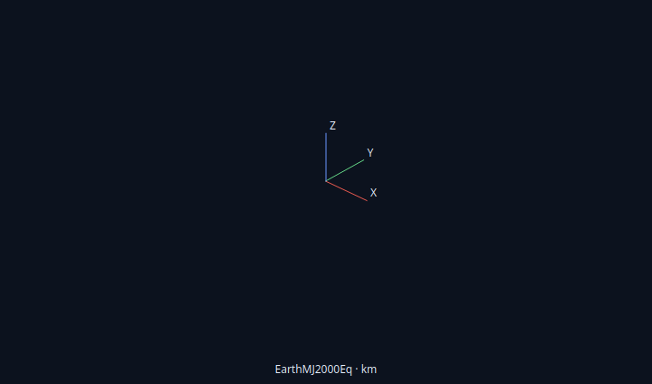
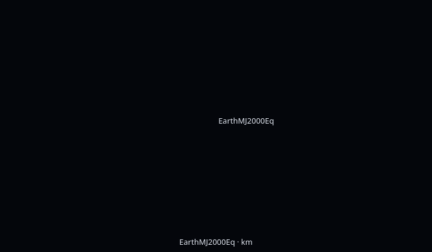

# Coordinate labels — 2026-10-04

The active OF AxesLabels and FrameLabel operations now convert to validated Qt
metadata and have independent Default/On/Off controls in OrbitView / Advanced /
Object drawing / Frame labels. XYZ text defaults On and follows the Axes switch;
the coordinate-system name at the origin defaults Off and may appear with axes
hidden. Both are independent of the object Show labels master. The renderer's
existing axis length is retained; this does not invent legacy AxesLength support.

The [source comparison](of-remaining-controls-20261004.md) records the actual wx
controls and backend semantics. Conversion preserves source order, including
subsequent Add assignments, and rejects invalid flags without changing source.
Missing overrides retain the defaults. Native OSG and fallback rendering share
the label geometry, using their current camera projection and clipping.

## Focused verification

Four directly affected checks pass:

| Check | Result |
| --- | --- |
| QtGui.NativeCoordinateLabels | 0.46 s, private Xvfb / software GL |
| QtGui.ObjectDrawingLayout | 0.18 s |
| QtGui.CoordinateLabels | 0.42 s, offscreen |
| QtGui.SegmentLabels | 0.39 s |

The new check covers strict conversion/JSON flags, independent default labels,
XYZ suppression without removing lines, origin text with axes/object labels
hidden, behind-camera clipping and unchanged raw samples. It also opens the
actual resource dialog, cancels and applies pending choices, verifies unrelated
source, invalid-edit rollback, Undo/Redo, Unicode Save/reopen, Default clearing
and plot Rename/Undo. A new short ten-second point-mass mission produces a
byte-identical complete 105-byte report with and without the viewer: SHA256
`a972d0247e997584f7d2df0d41e9e4a6ca1ec0ebf59750509387d5878cc51aa2`.
No completed tutorial, shipped example, audit or unaffected suite was repeated.

The first run caught ResourceEditor's Apply path trying to parse frame-wide
choices as per-object maps. The repair passes these two flags directly through
the existing atomic metadata transaction. Only the failing focused check was
rerun after this change; the renderer and layout passes remain applicable.
The synthetic fixture's isolated point supplies the existing scene extent;
there is no trajectory segment contributing to its pixel comparisons.

[Build logs](coordinate-labels-build-20261004.txt),
[check logs](coordinate-labels-checks-20261004.txt) and the
[runtime receipt](coordinate-labels-receipt-20261004.json) retain this checkpoint.
Exact initial/final CTest logs, raw reports, script and captures are under
`build/linux-gui/coordinate-labels-20261004/raw/`; committed logs trim trailing
whitespace. Visual inspection confirms readable endpoint and origin labels:

## Runtime and scope

GmatQt is rebuilt at **6,260,520 bytes**, SHA256
`e823c522d793e1c7004123f8bfb994732339b9ffea460c4b3946ac7e71e9f9ab`.
Base/util/Qt startup remain byte-identical to the preceding checkpoint. Work
stays in `/home/dan/GIT/GMAT-Qt`; the original checkout is untouched.
LastN solver retention remains a separate active requirement. All nine gates,
held scientific cases and external dependency dispositions remain intact.
Live host testing stays stopped: Mutter's null Wayland resource fault is
established, while GMAT client attribution, host repair and physical-GPU
acceptance remain unproven. Windows/macOS/MATLAB remain deferred. This bounded
software-renderer result does not establish full qualification.
