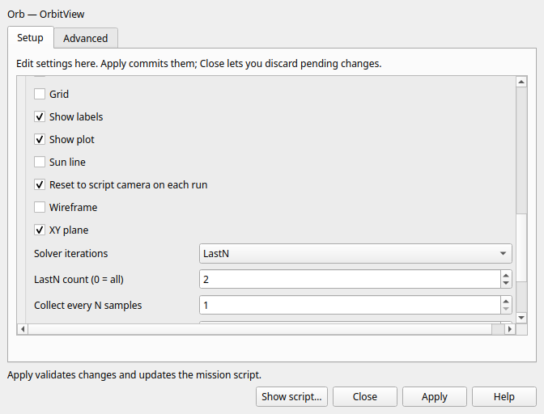

# LastN solver trajectory display — 2026-10-04

OrbitView now offers **LastN** in Solver iterations, with **LastN count (0 = all)**
in the primary form and setup dialog. The count defaults to 1 and is enabled
only for LastN. Controls stay pending, and explicit All/Current/None removes the
LastN override. Imported camera metadata remains intact when editing this count.
The count is strict, nonnegative and integral; invalid input preserves source.

## Conversion and retained history

The [targeted source comparison](of-remaining-controls-20261004.md) records the
active legacy operation. Qt preserves its constructor backing count1, explicit
All/None reset0, Current reset1, ignored counts before LastN, and final source
order. LastN is metadata on a numerical OrbitView using All, so the existing
subscriber supplies trial points; unsupported LastN no longer reaches its enum
setter. Zero retains unlimited trial trajectories, subject to MaxPlotPoints.

Each plotted object's nonempty finalized groups are limited to **2×N**. A group
is a finalized propagation trajectory, not a complete solver iteration; Current
retains its existing, separate behavior. An opt-in display callback in OrbitView
supplies actual SOLVING / SOLVEDPASS / REGULAR state at end of receive. Identity
is not guessed from provider names or epoch resets. Accepted samples and regular
segment labels remain intact. Eviction updates corresponding cameras, named and
reset views, vectors and replay cursors. Clear/trim lifecycle clears or prunes
bookkeeping. Long active paths use amortized bookkeeping cleanup rather than a
full history scan on every sample.

Solved-pass cleanup retains the legacy two-removal guard for plotted object
groups: spacecraft lose latest trial groups and non-spacecraft trial groups are
cleared. Repeated callbacks cannot keep deleting historical trials. Ordinary Qt
in-progress samples remain visible and do not evict finalized groups until their
own finalization. This is an explicit presentation choice.

**Bounded parity limit:** the legacy frame-map may also contain decorative
EclipticPlane/star listener keys in some coordinate systems. Those keys can shift
whether the first or second SOLVEDPASS callback consumes the two removals. Qt's
cleanup counts plotted SpacePoint groups. The per-object 2×N capacity is not
affected, but exact decorative-listener callback distribution is not qualified
or claimed equivalent. Broader solver/scientific regimes remain at their prior
qualification scope.

## Focused evidence

- **QtGui.LastNSolver — 0.51 s:** source ordering, 0/1/2 capacities, empty and
  in-progress groups, explicit boundaries, accepted labels, shared camera and
  per-source vector ownership, replay pruning, cleanup guard, trim/reset and
  amortized frame-set bounds. Actual controls cover pending setup Cancel, count
  Apply, strict rollback, exact other camera metadata/source, Undo/Redo, Unicode
  Save/reopen, All clearing and Rename/Undo. Replay and Output close/reopen retain
  the resulting histories. The control capture was inspected for readability.
- **QtGui.SolverPlots — 1.37 s:** directly affected All/Current/None/All form
  routing, source/reopen/report and plot history regression. Existing accepted
  histories and numerical objective checks pass. This is the ordinary DC check,
  not a repeat of optimizer/nested variants or the shipped-example corpus.

One new short DC fixture uses two ten-second propagation pieces while solving
Alpha=4. All has **78 trial points**, LastN2 **6**, and both retain the same
**12 accepted spacecraft points**. Earth trial points are cleared on acceptance.
The complete **15-row, 1,965-byte** reports are byte-identical, SHA256
`f4d6ca66177c95ad7d9e0d25344b2aeaf14ce4bf3775ec8fba3ea2e54ae34915`.
The first fixture attempt lacked a newline between converted resource metadata
and BeginMissionSequence; it failed before the new reference ran. That test-only
construction was corrected and only LastNSolver was retried. A test-only missing
QDialog include was also corrected after the initial compile failure.

[Build](lastn-build-20261004.txt), [check summary](lastn-checks-20261004.txt),
[initial CTest](lastn-first-ctest-20261004.txt) and
[final CTest](lastn-final-ctest-20261004.txt) logs retain these failures and passes.
Committed logs trim trailing whitespace; exact logs, scripts, reports and capture
remain under `build/linux-gui/lastn-20261004/raw/`. No completed tutorial, broad
audit, shipped-example run or unrelated passing suite was repeated.

## Rebuilt runtime and qualification limits

The [receipt](lastn-receipt-20261004.json) records GmatQt at **6,306,584 bytes**,
SHA256 `e48df911a0fc09622a1dc87071fe78eef7dee790bd6d41161b8ff9a848883a83`.
Base changes to SHA256
`5d455c6b0300e930dd9d9550f03e087b68fcded2508fa1304e5a031af77a100e`
for the optional display lifecycle callback; no numerical algorithm changed.
Util and Qt startup remain byte-identical. The dependent selected plugins were
relinked by the normal build. Work remains in `/home/dan/GIT/GMAT-Qt`; the
original checkout is untouched.

All nine acceptance gates and held/external-input dispositions remain intact.
Live host testing stays stopped. Mutter's null Wayland resource fault is
established, while GMAT client attribution, host repair and physical-GPU
acceptance remain unproven. Windows/macOS/MATLAB remain deferred. Full
qualification is not claimed.
