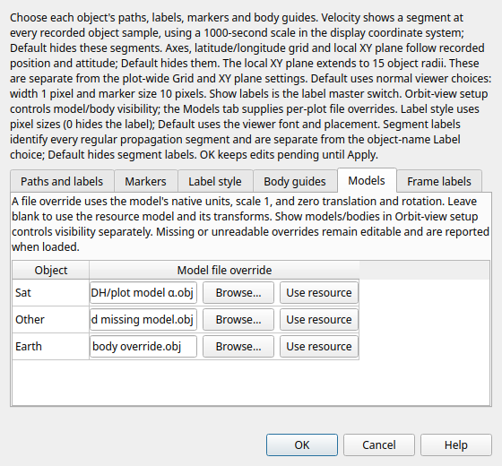

# Per-plot model files — 2026-10-04

The active `DrawModelFile` operation now has script conversion, a usable **Models** page in OrbitView **Object drawing…**, and native 3D geometry. Each Add object offers an editable file path, **Browse…**, and **Use resource**. Blank restores the resource model and its transforms. Edits remain pending until Apply, with Cancel/discard, exact no-op/Undo/Redo, invalid-edit recovery, Rename, creation, pruning and Unicode Save/reopen evidence.

## Source contract and correction

The inspected OpenFramesInterface checkout is `0e78aa50ae01fa234155ac105286004ad03884a5`. `DrawModelFile` is STRINGARRAY_TYPE (`src/base/subscriber/OpenFramesInterface.cpp:83,133`). Its scalar setter writes the current Add object, advances a per-plot cyclic counter, and returns false with no objects (`:1284–1295`). The actual GMAT script interpreter separates braced arrays and sends **each entry to that scalar setter** (`src/base/interpreter/Interpreter.cpp:6832–6862,6999,6608–6622`). Consequently repeated and partial arrays continue from the counter; quoted empty clears one override and advances; `{}` is a no-op. Raw spaces, quoted commas, Unicode and backslashes remain literal. Enclosing quotes are removed without decoding doubled apostrophes or backslash escapes.

The related Add correction follows the actual OBJECTARRAY script route: scalar/braced Add appends unique names, preserves existing object settings and initializes defaults only for new objects. The OF indexed Add setter (`OpenFramesInterface.cpp:1458–1462`) and target OrbitPlot `AddSpacePoint` (`src/base/subscriber/OrbitPlot.cpp:1693–1737`) both append. Empty Add is a no-op. Earlier converter/test assumptions that a repeated script Add resets defaults were based on the separate direct whole-list helper. Those affected assertions now use the interpreter route. Active original Add statements remain intact; final accumulated names validate trajectory-camera membership.

The direct OF braced model-file helper instead writes a prefix without advancing its scalar counter (`OpenFramesInterface.cpp:1263–1274`). Direct whole-list Add clears values and does not reset the model counter; indexed/bulk DrawModelFile helpers have separate legacy fallthrough defects. This checkpoint implements the **script path**, not those helper defects. Earlier bounded font/guide records retain their original runtimes; their repeated-Add claims are superseded here.

A separate actual script-order gap remains: repeated/partial `DrawFontPosition` arrays still use the converter's direct-prefix interpretation. Its ordinary controls and recorded pixels remain bounded evidence, but cyclic script fidelity is a required follow-up. This checkpoint does not claim all OF source ordering is qualified.

## Runtime and renderer

`OFSpaceObject.cpp:200–240` selects a nonempty per-plot override before the spacecraft/body resource file. An override uses scale 1, offset 0 and rotation 0; an empty value inherits resource transforms. OpenFrames loads raw asset dimensions (`dep/OpenFrames-git/src/Model.cpp:96–105`), without Qt's existing resource-spacecraft normalization and display exaggeration. Qt now records an explicit override flag, bypasses both normalization and resource transforms, reloads when that flag changes even with the same filename, and uses raw bounds for framing. Object visibility remains independent.

The receiver snapshots spacecraft, celestial-body and GroundStation assets separately for each plot. Relative paths resolve from the script directory and configured model fallback; resolved paths and transforms remain frozen for replay. Clearing an override refreshes inherited assets without changing the resource. Missing files remain editable, report a load warning, and use the existing sphere or marker fallback. Qt does not retain an obsolete mesh after a failed replacement, unlike a possible legacy loader behavior. The legacy active scene recognizes Spacecraft/CelestialBody/GroundStation; this is not a claim for its unrecognized plain BodyFixedPoint case.

Mesh geometry is a **native renderer** capability. The existing QPainter fallback remains a sphere/marker approximation; runtime fallback captures below verify retained presentation and lifecycle, not model-mesh pixels.

## Focused verification

Four new and fourteen directly affected existing checks pass across two recorded builds. The first build and all eighteen selected checks passed. Visual review exposed clipped Models help and a single visible row at the initial 560×380 size; the initial height is now 520, bounded by the available screen. After rebuilding the actual app, only ModelDrawingEditor and ObjectDrawingLayout were repeated, and both passed. No unrelated passing matrix, completed audit, tutorial or shipped-example run was repeated.

| Check | Latest relevant result | Raw log |
| --- | --- | --- |
| QtGui.ConvertedFonts | PASS 0.83s | tests-01.log |
| QtGui.ConvertedMarkers | PASS 0.72s | tests-01.log |
| QtGui.ConvertedVisibility | PASS 0.84s | tests-01.log |
| QtGui.ConvertedWidths | PASS 0.79s | tests-01.log |
| QtGui.FontMetadata | PASS 0.07s | tests-01.log |
| QtGui.ModelDrawingBackend | PASS 0.24s | tests-01.log |
| QtGui.ModelDrawingEditor | PASS 0.42s | tests-02.log |
| QtGui.ModelDrawingRuntime | PASS 0.20s | tests-01.log |
| QtGui.NativeModelDrawing | PASS 1.46s | tests-01.log |
| QtGui.NativeOrbit | PASS 3.67s | tests-01.log |
| QtGui.ObjectAxes | PASS 0.25s | tests-01.log |
| QtGui.ObjectDrawingLayout | PASS 0.20s | tests-02.log |
| QtGui.ObjectGuides | PASS 0.32s | tests-01.log |
| QtGui.ObjectVelocity | PASS 0.34s | tests-01.log |
| QtGui.OpenFramesSyntax | PASS 0.14s | tests-01.log |
| QtGui.OrbitSetup | PASS 1.52s | tests-01.log |
| QtGui.ResourceRename | PASS 0.64s | tests-01.log |
| QtGui.SegmentLabels | PASS 0.47s | tests-01.log |

The new backend check covers actual cyclic model-file assignment, scalar/braced/duplicate/empty Add, retained/new defaults, accumulated trajectory references, strict metadata, per-plot isolation, exact no-op/source recovery and atomic Apply/Undo/Rename/reopen. The editor check reaches visible Browse/Cancel/reset controls and checks pending/discard, creation and source transactions. The runtime check uses real spacecraft/body/station objects, script-directory and startup lookup, frozen identity/resource transforms, missing paths, independent visibility, engine replacement, close/reopen and unchanged raw snapshot bytes. It publishes synthetic receiver inputs; it does not qualify a new numerical mission.

The new native check uses independently authored green 40×20 and red 12×30 OBJ planes and analytic orthographic pixel expectations. Raw override pixels are **112×56**, against expected111.514×55.757; a recorded 90° attitude produces55×111. The same file inherited with the existing spacecraft convention is498×250; switching only the override flag restores112×56, and resetting restores498×250. A second plot remains34×84 with byte-identical pixels. DrawObject hides the mesh; missing body and spacecraft files show22×22 sphere and6×6 marker fallbacks. Retained sample SHA is byte-identical before/after: `ddf9e6fcad682db3d64b09c31e43823ac400194aa0fadfd95d836b71ed281e99`.

These native captures used private Xvfb/xcb and **llvmpipe (LLVM 21.1.8, 256 bits)**, Mesa26.0.8, OpenGL4.5 compatibility profile. They do not qualify the live host, compositor or physical GPU. No fresh propagation was needed; directly affected existing synthetic checks retain their numerical-reference comparisons. Base/util/startup are byte-identical.

## Runtime receipts and limits

Final rebuilt `application/bin/GmatQt`: **6,740,736 bytes**, SHA256 `ab87e2e42e143cb22417c48e34877d7ef3a2e7657e2399c42ed2b4e6ff63f0d7`. The first build was SHA `00bfd6ee…`; native/runtime/backend and earlier affected passes bind that recorded build. The final application differs only in initial dialog height. Final editor/layout passes bind the final build; earlier passes are not relabeled as a fresh full matrix.

[Receipt](model-drawing-20261004.receipt.json) binds baseline `7e83ebe4…`, implementation/source hashes, application/test identities, results and limits. [Raw archive](model-drawing-20261004.raw.zip) contains both builds, JUnit and full CTest output, source patch/fingerprints, model fixtures, PNGs, source/snapshot bytes and a per-file manifest. Archive SHA256: `0cd903c1d8b93f8f7a14f6a988a8fe831f510c27069d4a58b7b6837eb8025d22`; all manifest member hashes were verified.

All nine original acceptance gates remain in scope. Held Lunar/L2 and scientific/external dependencies remain required or explicitly deferred; Windows/macOS/MATLAB remain deferred. Saved Mutter evidence identifies a null Wayland resource fault, while GMAT client attribution and host/GPU acceptance remain unproven. **Live host testing stays stopped. Full qualification is not claimed.** The original `/home/dan/GIT/GMAT/GMAT` checkout is untouched.
