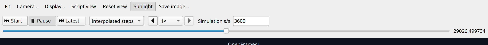
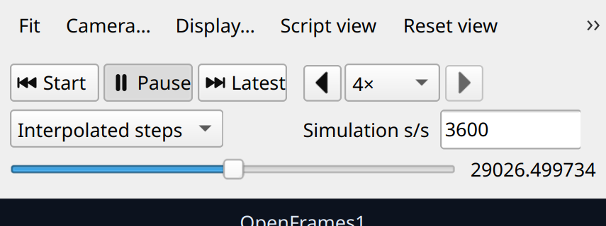

# Compact playback controls — 2026-10-05

The user supplied a screenshot showing stretched playback buttons, speed controls
at opposite ends and a full-width simulation-rate field. `PlotWidget.cpp` now
keeps Start/Play/Latest together, pairs Slower/Faster with the multiplier,
places mode/rate beside them and gives the timeline its own full-width row.
The rate field is sized from its font metrics rather than stretched across the
viewer. Existing object names, actions, callbacks, modes and numerical data
remain unchanged.

At wide widths, playback occupies two rows. Whole control groups wrap at tiled
widths; the captured600/380-logical-pixel viewers use three rows. Narrower
windows can put the rate on its own row. Expanding the viewer restores the
compact wide layout. These choices follow widget size hints and desktop font
metrics, rather than a fixed physical-pixel threshold.

Both images render the actual PlotWidget with synthetic retained history,
a3600s/s clock and4× multiplier under offscreen Qt at225% scaling. They are
layout previews, not a new mission execution or host/GPU qualification.
Captured playback heights are52logical pixels at1200wide,81 at600/380wide,
and52 again after expanding. The rate field remains89logical pixels; every
captured control stays inside its panel.

GmatQt and the two directly affected test targets rebuilt successfully. Existing
InterpolatedPlayback and PlaybackOptionsRuntime checks pass0.08/0.23s, covering
mode/speed behavior, interpolation/raw sample retention, simulation rate editing
and synchronized runtime controls. No old audit, tutorial, numerical example or
unrelated passing matrix was repeated. Base/util/startup are unchanged. The
original checkout was untouched. Full replacement and host/scientific gates
remain open.

[Source/runtime/geometry receipt](playback-layout-20261005.receipt.json) records
hashes and commands. Build/test logs, exact helper sources and all four captures
are retained under `build/example-qualification/20261005/playback-layout`.
The preview helper’s initial QMap/vector mistake is separate from the successful
production build and directly affected checks.
