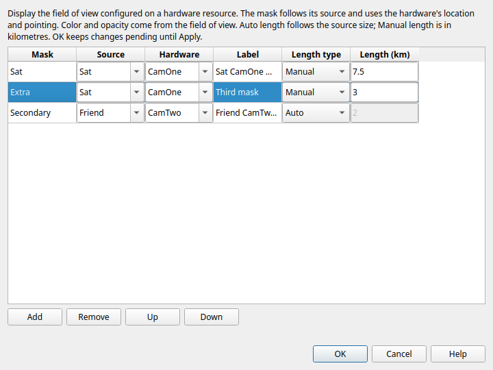
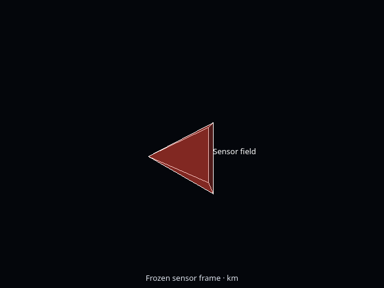
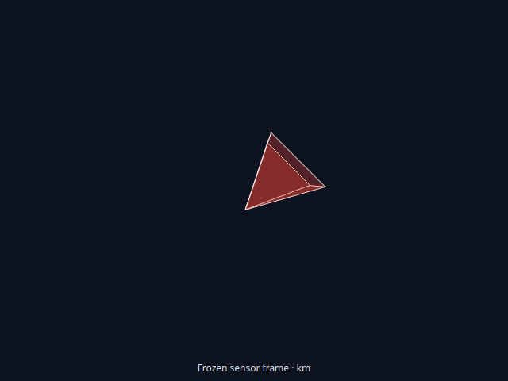

# Sensor-mask conversion, controls and display — 2026-10-04

OrbitView / Advanced / **Sensor masks…** now provides ordered Add/Edit/Remove/
Up/Down operations. Each row has a name, plotted source, hardware, label and
Auto/Manual length. Auto uses the source model's native bound radius when
available, the celestial body's radius otherwise, or 1 km for a point object;
Manual is a positive axial length in kilometres. Dialog OK remains pending until
parent Apply; Cancel/discard preserves the source. Remove or reassign a dependent
mask before removing its source from OrbitView Add. Invalid references stay pending
for correction. Source/hardware Rename preserves mask names and literal labels.

## Source-backed capability

This is an active missing OF operation, separate from the completed 108 wx audits.
The legacy `OpenFramesInterface/src/gui/subscriber/wx/OFConfigurationPanel.cpp`
exposes mask creation, selection, editing and deletion; `OFSensorMaskDialog.cpp`
edits Source/Hardware/Label/LengthType/Length. `OpenFramesSensorMask.cpp` supplies
Auto/1 defaults and positive lengths. Qt previously rejected its declaration.

Conversion now preserves declarations as comments and stores supported settings
in Qt metadata. Scalar SensorMask appends, braced lists replace, duplicates are
ignored and an empty list clears. Unsupported/dynamic fields preserve the original
source with an explicit diagnostic. Source is a bare plotted SpacePoint. Hardware
uses the legacy global lookup, so valid imported hardware need not be attached to
that source. The hardware must reference a supported FOV.

The geometry follows legacy `wx/OFScene.cpp:1458–1623`: ConicalFOV uses 120 circular
boundary points; RectangularFOV uses its stored width/height angles directly;
CustomFOV uses its initialized cone/clock boundary. Tangents form an axial base
plane, rather than normalized rays. Hardware location and inverse look-at mount
rotate the local -Z boresight into body coordinates. FOV color/alpha control the
sides; white base/radial edges and an independent white axial-end label match the
legacy display. Conical masks omit radial edges.

The receiver freezes the mount and shape while engine objects exist. Native and
fallback rendering follow retained/interpolated source pose without engine access.
Missing/before-first or hidden sources suppress masks; hiding only the spacecraft
model still allows its mask. A later absent publication retains the source's last
real pose, consistent with existing body rendering. Masks describe FOV geometry;
no visibility, occultation or surface-footprint calculation is added or changed.

## Focused verification

- **SensorMaskBackend — 0.32 s:** conversion/defaults/ordered list handling,
  strict metadata/source rejection, all three receiver shapes, hardware mount,
  color/alpha, global references, invalid references, Output reopen and replay
  after replacing the engine objects.
- **SensorMaskEditor — 0.46 s:** actual pending dialog controls, Cancel/discard,
  Add/Edit/Up/Down/Remove, Auto/Manual enabling, parent Apply, exact Undo/Redo,
  unrelated source/camera retention, Unicode Save/reopen, reference Rename and
  invalid-reference rollback. The offscreen dialog capture was inspected.
- **SensorMaskRendering — 0.80 s / NativeSensorMasks — 1.04 s:** independent
  projected outline/fill positions, mount/attitude/axial length, Auto bounds,
  three shapes, alpha, white edges, independent labels, missing/hidden/removal,
  recorded/interpolated replay and unchanged frozen geometry. Native rendering
  used private Xvfb with llvmpipe (LLVM 21.1.8, 256 bits). Representative captures
  were inspected in both renderers.
- Directly affected **NativeVectors — 1.41 s**, **ResourceRename — 0.65 s** and
  **OpenFramesVectors — 0.44 s** pass. Shared rendering/conversion/Rename changes
  justify these focused repeats. No broad audit/tutorial/example corpus reran.

One new 20-second propagation fixture writes the complete **131-byte** report
identically with and without masks, SHA256
`c122bfc4ca5060f14ab0ad5fbe7e9fdf110cbda79217becc1ea34f0964e86502`.
No numerical algorithm or visibility calculation changed.

The first build failed on unsupported QJsonObject cbegin/cend spelling; the
selected Qt requires constBegin/constEnd. The first editor fixture used a primary
camera name with spaces, and its initially premature diagnostic string hid the
reason. A diagnostic-only retry identified it, then a valid fixture name passed.
The fallback's first outline assertion required nearly pure white, despite the
correct antialiased line at the independent projected position. Its corrected
fallback-only threshold requires a bright neutral pixel; native assertions and
the implementation are unchanged. Only failing new checks were retried after
these test corrections. All original outcomes are retained.

[First build](sensor-masks-20261004-build-first.txt),
[final application/test build](sensor-masks-20261004-build-final.txt),
[first seven-check run](sensor-masks-20261004-checks-first.txt),
[editor diagnostic](sensor-masks-20261004-editor-diagnostic.txt),
[editor pass](sensor-masks-20261004-editor-final.txt) and
[fallback pass](sensor-masks-20261004-fallback-final.txt) record the outcomes.
Committed readable logs trim trailing whitespace; the [raw archive](sensor-masks-20261004-raw.zip)
preserves exact logs, sources, reports and captures. Its [receipt](sensor-masks-20261004-receipt.json)
indexes file sizes/hashes and source snapshots.

## Rebuilt application

`application/bin/GmatQt` is **6,432,232 bytes**, SHA256
`d27a4103f7916d313870ca3ac4512d9fdde832f8800507dc311bd5e3b9d22052`.
Base/util/Qt startup are byte-identical to the preceding LastN runtime. The final
changes after this rebuild affect only the two new test fixtures. Work is on
`codex/qt6-gui` in `/home/dan/GIT/GMAT-Qt`; the original checkout is untouched.

All nine original acceptance gates and existing held/dependency dispositions remain
visible. Live host testing remains stopped. The saved Mutter NULL Wayland-resource
fault is established, while GMAT client attribution, a safe/repaired host and
physical-GPU acceptance remain unproven. Windows/macOS/MATLAB are deferred.
Full replacement qualification is not claimed.
