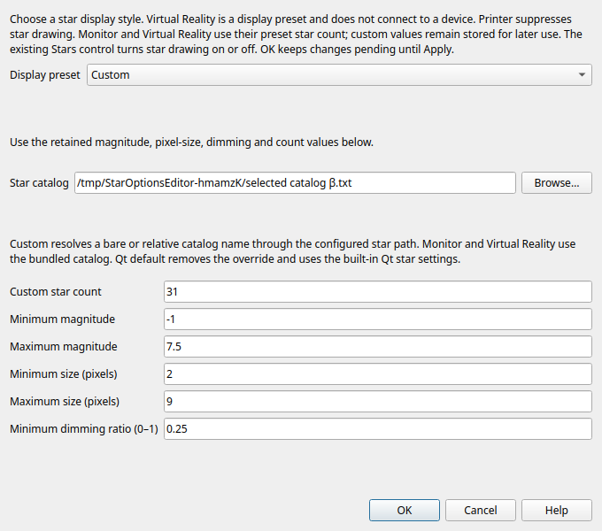
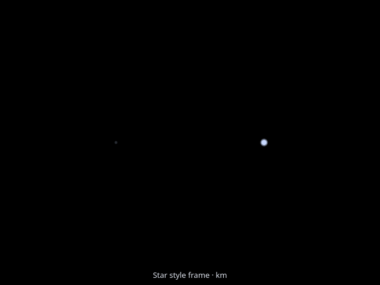
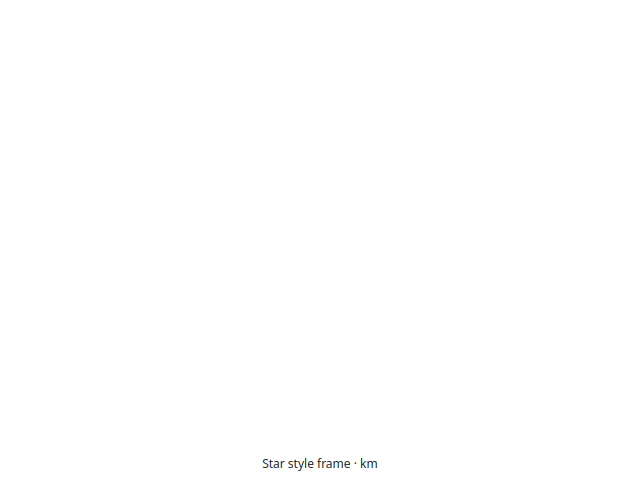

# Star display options — 2026-10-04

Work in `/home/dan/GIT/GMAT-Qt`, `codex/qt6-gui`, from a107d74c.
This closes the active OpenFrames star options operation at the scope below.
It is not full GUI qualification or host/GPU acceptance.

## Missing operation and implementation

Before this change, conversion retained StarSettings, StarCatalog, MinStarMag,
MaxStarMag, MinStarPixels, MaxStarPixels and MinStarDimRatio only as comments.
The existing star count/enable controls and five native grayscale size groups
could not express those active legacy controls. The fallback had no star sky.

OrbitView / Advanced / **Star options…** now offers Qt default, Monitor,
Virtual Reality, Printer and Custom. Custom values remain stored while a preset
is selected. Qt default removes the override and keeps ordinary Qt count/style.
The existing Stars checkbox remains the enable control. Virtual Reality names
a display preset; no device operation is implemented or claimed.

Monitor uses magnitude −2 through 6, up to 40,000 admitted catalog rows, sizes
1–10 pixels and dimming floor 0.5. Virtual Reality uses sizes 1–5 and floor 0.1.
Custom retains the count/catalog and five real bounds. Printer suppresses stars,
uses a white background and readable dark overlays. Conversion preserves
source-ordered setter validation and custom values independently of preset order;
invalid input retains source. The visible primary count, Advanced backing value and Star options count share
one pending value. Dialog acceptance and Apply preserve the last user edit.

Styled catalogs retain source order, accept the legacy RA-hours header and B-V
color index, filter magnitude before counting, and use the legacy nonlinear
size/dimming relation. Native and fallback sprites follow the recorded inertial
frame and camera orientation at infinite distance, with body occlusion. Ordinary
Qt native styling remains unchanged. No numerical algorithm or state is modified.

The existing OpenFrames HYGv3 display catalog is copied unchanged to the normal
STAR_PATH, with its [version-specific attribution](../../../application/data/graphics/stars/HYGv3-NOTICE.txt).
Its 1,297,317 bytes have SHA256
d35613305497545936a92d89266f7f6d968245af1a9cf21e2c8943608f60f64f.
The existing Qt catalog and startup selection remain unchanged. Empty trailing
tab-separated catalog columns are deliberately preserved; a file-specific Git
whitespace attribute permits those unchanged data rows.

## Authoritative source

Read-only legacy sources under `/home/dan/GIT/OpenFramesInterface`:
`src/gui/subscriber/wx/OFStarsDialog.cpp` active preset/count/five-value controls;
`src/base/subscriber/StarOptions.cpp` default catalog and effective presets;
`src/base/subscriber/OpenFramesInterface.cpp` custom setters and their order;
`src/gui/subscriber/wx/OFScene.cpp` preset application;
`dep/OpenFrames-git/src/SkySphere.cpp` header units, source-order admission,
B-V color and nonlinear diameter/dimming. HYGv3 licensing is retained separately
from code licensing in the bundled notice.

## Verification

The first application build succeeds. Initial focused checks pass Backend 0.29s,
fallback 0.75s, private NativeStarStyles 1.05s, affected NativeOrbit 3.72s and
SkyControls 0.28s. Native rendering reports llvmpipe (LLVM 21.1.8, 256 bits).
Independent HYG Sirius coordinates verify hours rather than degrees, and the
pixel checks verify admission, size/dimming, body occlusion and frozen source data.

The first Editor check uses the wrong core string accessor for the On/Off
EnableStars field; it is corrected to the typed accessor. The affected OrbitSetup
check reproduces stale primary form values overwriting pending object/camera
values on dialog reopening. Its overlay is limited to actual primary edits.
The primary StarCount control is synchronized with the backing table in both
directions. The raw first failure and diagnostic values remain preserved. The affected OrbitSetup check then passes 1.59s. Its temporary diagnostic prints
are restored without changing assertions. The new editor check first passes 0.46s;
a final configuration-only LastN count 3 reopening assertion and explicit retained
count carry-through pass 0.46s. Only the failing/newly affected editor test
is repeated after its corrections. Its selected StarCount assignment may move to
the standard pre-mission location; the test verifies a single count 31 assignment
and byte-identical unrelated source/comments, exact Undo/Redo and Unicode reopen.
The original wrong-accessor, stale-pending and fixture-placement failures remain
in the logs rather than being presented as initial passes.

Review also repairs paired count edit order and unchanged imported preset OK:
metadata customCount 40000 can coexist with backing core default 7000, and opening
and accepting without an intentional edit must preserve source/model/Undo.

All complete numerical reports/assertions in affected OrbitSetup remain part of
that existing test; the new backend/editor checks run no numerical mission.
The application, core libraries, startup and original-catalog identities are
recorded in the receipt. Final core/util/startup/original catalog are unchanged.

No completed audit, tutorial or shipped-example corpus is repeated. Private
Xvfb/llvmpipe and offscreen evidence cannot establish host/physical-GPU acceptance.
Live host testing remains stopped after the saved Mutter null Wayland resource
fault; GMAT client attribution and a repaired/safe host remain unproven.

## Concrete remaining OF operations

The next active source preferences still require implementation/evidence:

| Preference | Legacy use and current boundary |
| --- | --- |
| PlaybackTimeScale | CoordinateOptions default 3600 simulated seconds per wall second; OFScene applies toolbar value and WindowProxy scale/86400. Qt shared/local speed controls exist, but this saved absolute source scale is still commented during conversion. |
| TimeSyncParent | Active ClockTime/other-plot selector; OFScene disconnects or joins a parent clock. Qt shared playback exists, but this source parent relationship is still commented. |
| ShowToolbar | Active checkbox controls the viewer toolbar sizer. Its source preference remains commented. |
| DrawModelFile | Per-object, per-plot override precedes resource model defaults. Source array/prefix and cyclic scalar semantics exist; no active legacy per-plot GUI picker was found. Qt resource model selection exists, but this imported override remains commented. |

These are remaining operations, not requests to repeat completed audits. Device
VR/MSAA and inactive stored AxesLength remain separate. The nine original gates,
LastN decorative-listener distribution limit, held Lunar/L2 and external-data
cases remain visible. Windows, macOS and MATLAB remain deferred.

## Recorded application and artifacts

Final rebuilt `application/bin/GmatQt`: **6,507,840 bytes / SHA 43f55410…**.
Full hashes and source identities are in the [receipt](star-options-20261004-receipt.json).
Five first-run passes are bound to the first build recorded in the raw archive;
the remaining setup/editor passes cover the corrected pending controls. No
unaffected first-run renderer/backend check is represented as a fresh final-build
run. The rendering implementations are unchanged by the later editor corrections.

[First build](star-options-20261004-build-first.txt), [first seven checks](star-options-20261004-checks-first.txt),
[pending-value diagnostic](star-options-20261004-editor-orbit-diagnostic-checks.txt),
[setup correction](star-options-20261004-editor-orbit-correction-checks.txt),
[editor pass](star-options-20261004-editor-final-check.txt), and
[final LastN-aware editor check](star-options-20261004-editor-lastn-check.txt) retain the sequence.
The [raw archive](star-options-20261004-raw.zip) contains exact logs, frozen changed source,
script snapshots, captures and runtime hashes. Readable log copies trim only
trailing whitespace and empty trailing log lines. The original checkout is untouched.

