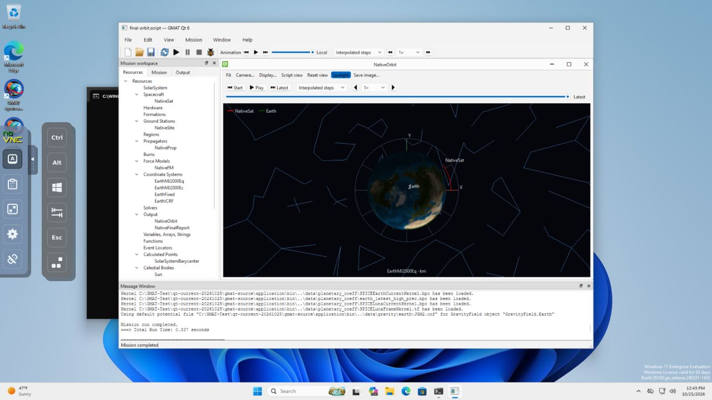

# Windows native rendering and regression integration — 2026-10-25

The dedicated Windows VM now renders native 3D orbit scenes and passes camera, animation and window lifecycle checks using software OpenGL. Seven portability fixes and focused product/test repairs are integrated locally on `codex/qt6-gui`, base `215be630654f66f3953528f58dea4cc2de639af9`, with earlier unrelated changes preserved. The changes are uncommitted.

## Verified results

| Scope | Result |
|---|---|
| Windows affected CTest suite | **9/9 pass**, 43.87 seconds |
| Linux affected CTest suite | **12/12 pass**, 39.89 seconds |
| Windows native orbit framework checks | **Pass**, 10.111 seconds |
| Windows native window lifecycle, three cycles | **Pass**, 24.725 seconds |
| Linux private Xvfb/xcb lifecycle, three cycles | **Pass**, normal event-loop exit at 19.703 seconds |
| Windows standalone mission, Unicode report, exit with GroundStation editor open | **Pass**, exit 0, no forced stop |
| Windows source identity | **4,471 files match**, zero differences, generated startup excluded |

Windows CTest checks: IsolatedWaylandExit helper contracts, Files, TreeActivation, PlaybackOptionsRuntime, Workflow, Mission, Plots, PlotsHiDPI and Launch. Linux adds NativeOrbit and its HiDPI/fractional variants. Actual console framework checks are separate from offscreen tests. Both use the existing Qt widget/event/assertion executables and CTest/Python harness, without Qt Test/QTest. Manual browser-viewer OS input additionally verified textured Earth/orbit/spacecraft, camera rotation and zoom, timeline rewind, moving animation and viewer close/reopen.

Final Windows `GmatQt.exe` SHA-256: `fbcd865ffbc1a035e6324e3309956e3a932cc3bc69488bca15ee8cecac6db995`. Final Linux `GmatQt-R2026a`: 6,750,008 bytes, SHA-256 `15af42f13b057a053393c21676d590c7479ff7ad16183d90563f42225168a853`. Full runtime/test identities and commands are in the receipt and raw evidence README.

## Renderer and fixes

The VM is Windows 11 Enterprise Evaluation 26200 with QXL, Qt 6.10.2, MSVC 19.44/C++17 and official OSG 3.6.5. Adding Qt's missing software DLL alone produced a valid Qt context while OSG/direct calls still reached system OPENGL32 with no current WGL context. Using the same official signed Qt Mesa DLL app-locally as both `opengl32sw.dll` and `opengl32.dll` makes both paths agree: **OpenGL 3.0 Mesa 11.2.2, llvmpipe**, current WGL context, non-null framebuffer. The final app loaded the verified local DLL. No Direct3D override, host driver change or OrbitRenderer source change was needed.

The [official archive](https://download.qt.io/development_releases/prebuilt/llvmpipe/windows/opengl32sw-64-mesa_11_2_2-signed_sha256.7z) was checked against [vendor checksums](https://download.qt.io/development_releases/prebuilt/llvmpipe/windows/sha256sums.txt); DLL Authenticode is Valid, The Qt Company Oy. Archive and DLL SHA-256 values, before/after probes and module hashes are retained. This legacy vendor runtime is a VM test fixture; it does not establish hardware GPU support or a distribution decision. [Qt's graphics documentation](https://doc.qt.io/qt-6.10/windows-graphics.html) covers the separate dynamic/direct paths.

Integrated portability changes: macro-safe numeric max/min, C++17 lambda capture, FieldOfView/CustomFOV exports, public OSG includes, the Windows `near` guard, and correct Windows executable resolution. Product regressions fixed: UTF-8 report filename open/remove/append; tolerance value edits preserving comma/tab/multiline whitespace; plugin-dependent workspace children destroyed before engine finalization unloads DLLs. The teardown fix is supported by the original access-violation stack/linker map and a successful normal exit with the GroundStation editor still open.

Test corrections retain temporary mission fixtures until MainWindow teardown, explicitly assert paste focus, compare canonical model-file identity across native path separators, and fail clearly on absent script/star prerequisites. Missing Hohmann/HYG assets were synchronized to the isolated guest from existing canonical assets with hashes and the catalog notice; shared source data was unchanged.

The numerical regression now uses the executing propagator's elapsed-time clock rather than rounded absolute epoch subtraction when aligning states. Measured integration offset was −4.9043410399463e−7 seconds versus −3.14321368932724e−7 from rounded epochs; raw state differences match velocity/acceleration times the former. Initial epoch 1e−9 seconds, endpoint/integration duration 1e−6 seconds, position 1e−6 km and velocity 1e−9 km/s checks remain enforced. No numerical tolerance was widened. Original failures, crash evidence, fixture timeouts and intermediate 8/9 run remain retained alongside the final 9/9 result.

## Evidence and remaining scope

- [Machine-readable receipt](windows-native-20261025.receipt.json).
- [Raw evidence archive](windows-native-20261025.raw.zip): README, exact commands, final Linux/Windows logs and JUnit, native test runners/results, source/binary hashes, patch, original failures, renderer probes, runtime fixtures and screenshots. `complete-ctest.*` is the final Windows run; `final-ctest.*` preserves the earlier 8/9 run.
- [Final editor-open scene](windows-native-20261025/10-final-open-station-editor.png); [earlier animation at 80.9%](windows-native-20261025/06-native-orbit-playing.png).

The VM is normally shut off. The temporary authenticated localhost viewer/container, private Unix console bridge, browser tab, port 55393 and ephemeral authentication files were removed; approved guest settings and test assets remain. Cleanup is recorded. The host compositor and other VM were untouched.

**Physical Intel/Wayland lifecycle remains unqualified.** These software-rendered VM and isolated Linux checks do not replace physical GPU/compositor acceptance. Full 165-test Windows/183-test Linux matrices, Windows C++11/14 alternatives and distribution testing were not run. No packaging, commit, push, publication or outreach occurred. See the existing [Linux lifecycle record](window-lifecycle-20261015.md) for the separately consented native-host procedure.
